# JDBC Proxy Driver - System Design Document

## Overview

The JDBC Proxy Driver is a comprehensive middleware solution that sits between applications and database drivers, providing transparent interception and instrumentation of JDBC operations. This document details the architectural decisions, design patterns, and system interactions.

## Architecture

### 1. High-Level Architecture

```
┌─────────────────────────────────────────────────────────────────┐
│                         Application Layer                       │
│  ┌───────────────┐  ┌─────────────────┐  ┌─────────────────┐   │
│  │  Spring Boot  │  │   Plain JDBC    │  │   JPA/Hibernate │   │
│  │  Application  │  │   Application   │  │   Application   │   │
│  └───────────────┘  └─────────────────┘  └─────────────────┘   │
└─────────────────────────────────────────────────────────────────┘
                                │
                    jdbc:proxy:... URL
                                │
┌─────────────────────────────────────────────────────────────────┐
│                     JDBC Proxy Driver                          │
│                                                                 │
│  ┌─────────────────┐    ┌─────────────────┐                   │
│  │  ProxyDriver    │    │ ProxyConfiguration                  │
│  │  (Entry Point)  │◄──►│  - Hook Registry │                   │
│  └─────────────────┘    │  - Thread Safety │                   │
│           │              └─────────────────┘                   │
│           │                                                     │
│  ┌─────────────────┐    ┌─────────────────┐                   │
│  │ ProxyConnection │    │   Hook System   │                   │
│  │  - Wraps JDBC   │◄──►│  ┌─────────────┐│                   │
│  │  - Applies Hooks│    │  │SqlRewriter  ││                   │
│  └─────────────────┘    │  │JdbcLogger   ││                   │
│           │              │  │ResultProc.  ││                   │
│           │              │  └─────────────┘│                   │
│  ┌─────────────────┐    └─────────────────┘                   │
│  │ ProxyStatement  │                                           │
│  │ ProxyPrepStmt   │    ┌─────────────────┐                   │
│  │ ProxyCallableStmt│◄──►│  Built-in Ext.  │                   │
│  └─────────────────┘    │  ┌─────────────┐│                   │
│           │              │  │Console Log  ││                   │
│           │              │  │Table Prefix ││                   │
│  ┌─────────────────┐    │  │Data Masking ││                   │
│  │ ProxyResultSet  │    │  └─────────────┘│                   │
│  │  - Row Processing│    └─────────────────┘                   │
│  │  - Value Transform│                                          │
│  └─────────────────┘                                           │
└─────────────────────────────────────────────────────────────────┘
                                │
                         Delegates to
                                │
┌─────────────────────────────────────────────────────────────────┐
│                    Underlying JDBC Drivers                     │
│  ┌───────────────┐  ┌─────────────────┐  ┌─────────────────┐   │
│  │   H2 Driver   │  │PostgreSQL Driver│  │  MySQL Driver   │   │
│  └───────────────┘  └─────────────────┘  └─────────────────┘   │
└─────────────────────────────────────────────────────────────────┘
                                │
┌─────────────────────────────────────────────────────────────────┐
│                         Databases                               │
│  ┌───────────────┐  ┌─────────────────┐  ┌─────────────────┐   │
│  │ H2 Database   │  │   PostgreSQL    │  │     MySQL       │   │
│  └───────────────┘  └─────────────────┘  └─────────────────┘   │
└─────────────────────────────────────────────────────────────────┘
```

## 2. Component Design

### Core Components

#### ProxyDriver
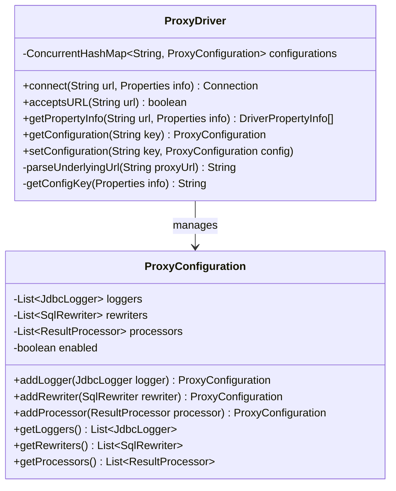

#### Connection Layer
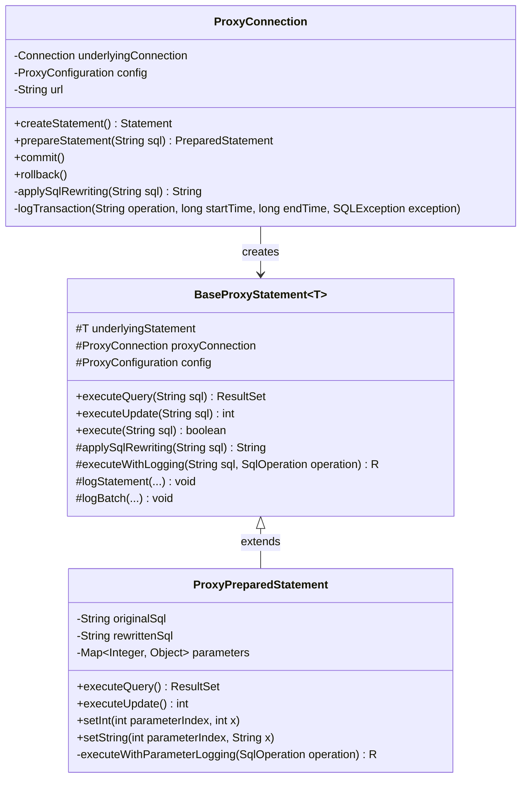

#### Result Processing
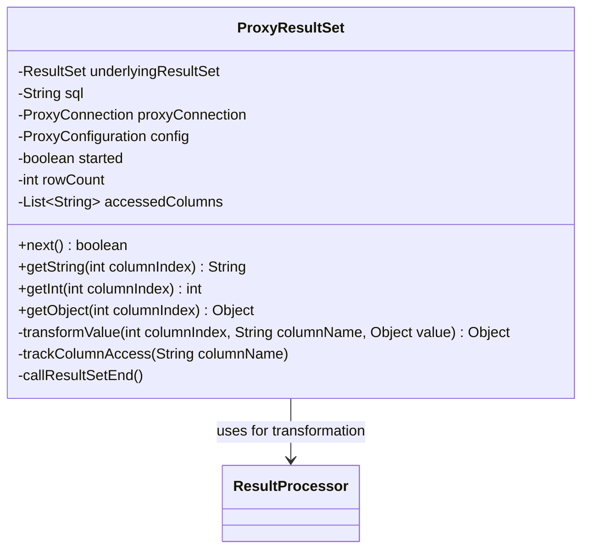

### Hook System Design

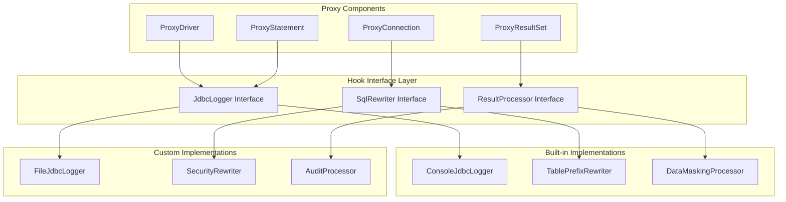

## 3. Interaction Flows

### Connection Establishment Flow

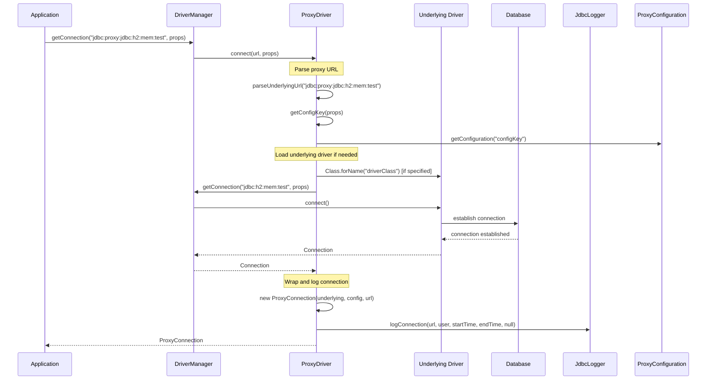

### SQL Execution Flow

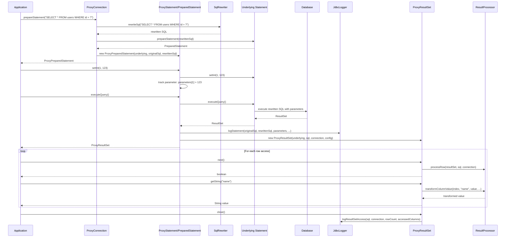

## 4. Configuration System

### Configuration Lifecycle

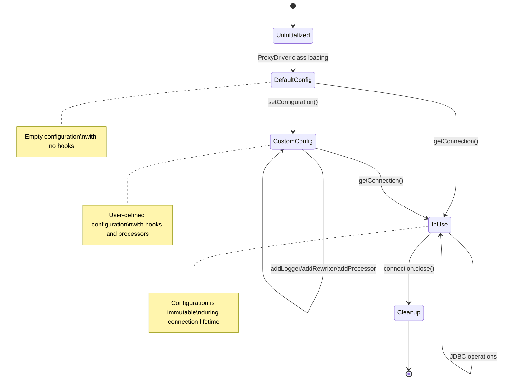

### Hook Priority System

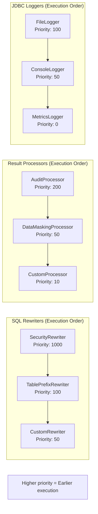

## 5. Thread Safety Model

### Concurrency Design

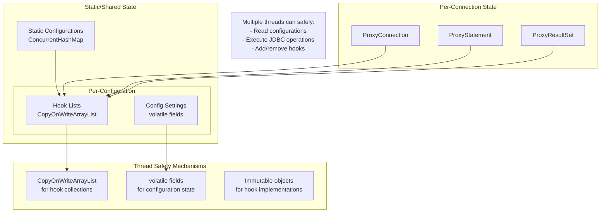

## 6. Error Handling Strategy

### Exception Flow

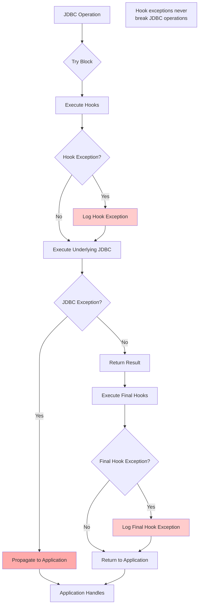

## 7. Performance Characteristics

### Performance Profile

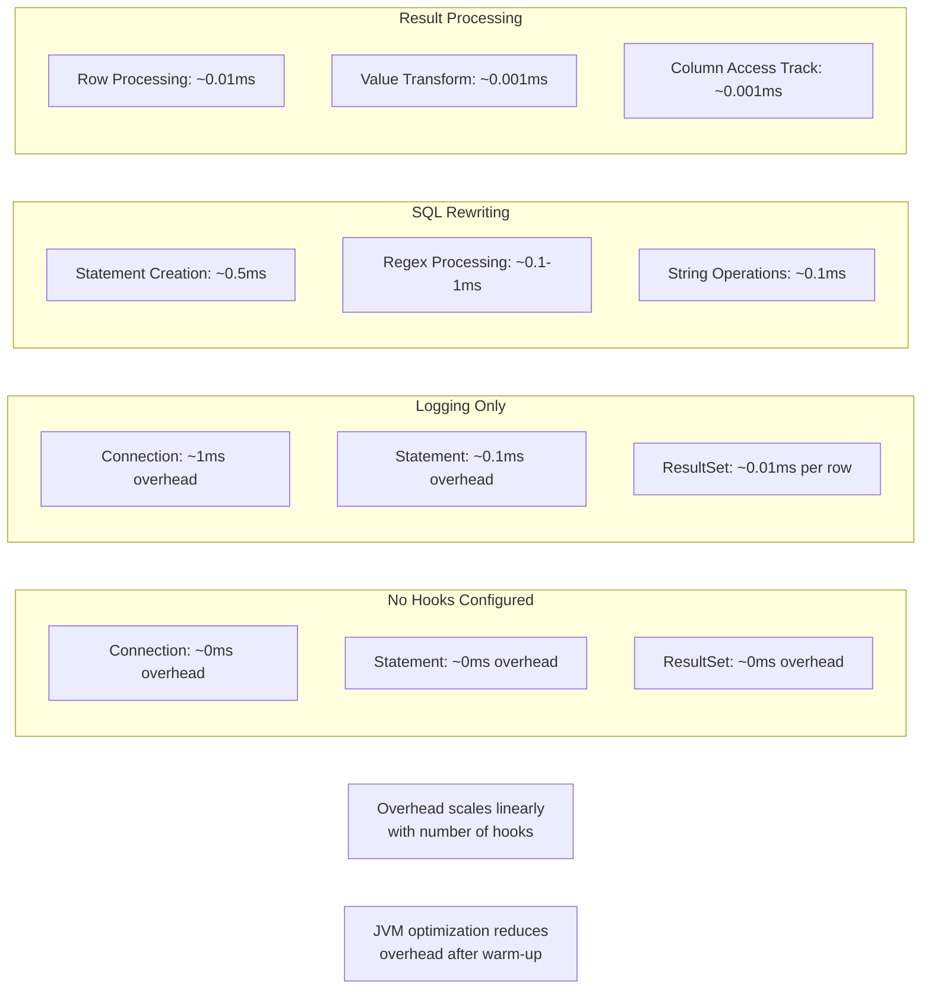

### Memory Usage

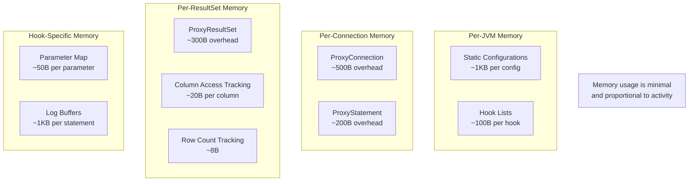

## 8. Deployment Architecture

### Embedded Library Model

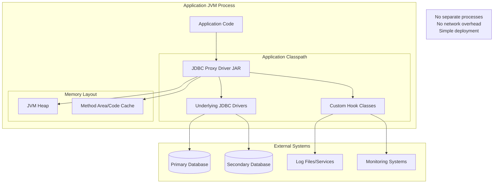

### Multi-Environment Configuration

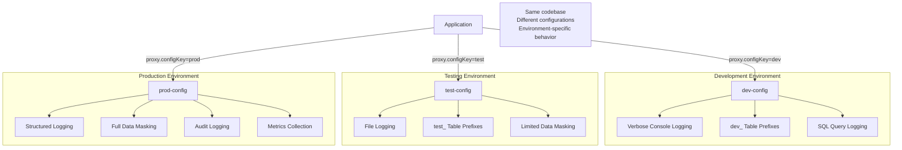

## 9. Extension Points

### Plugin Architecture

```mermaid
classDiagram
    class HookInterface {
        <<interface>>
        +getPriority() int
    }
    
    class JdbcLogger {
        <<interface>>
        +logConnection(...)
        +logStatement(...)
        +logTransaction(...)
        +logBatch(...)
    }
    
    class SqlRewriter {
        <<interface>>
        +rewriteSql(sql, connection) String
        +rewriteParameterizedSql(sql, params, conn) String
    }
    
    class ResultProcessor {
        <<interface>>
        +processRow(resultSet, sql, connection)
        +onResultSetStart(...)
        +onResultSetEnd(...)
        +transformColumnValue(...)
    }
    
    HookInterface <|-- JdbcLogger
    HookInterface <|-- SqlRewriter
    HookInterface <|-- ResultProcessor
    
    class CustomExtension1 {
        +getPriority() int
        +customMethod()
    }
    
    class CustomExtension2 {
        +getPriority() int
        +anotherCustomMethod()
    }
    
    JdbcLogger <|.. CustomExtension1
    SqlRewriter <|.. CustomExtension2
    
    Note1[Extensions implement interfaces<br/>and are automatically integrated<br/>via configuration system]
```

## 10. Security Considerations

### Security Boundaries

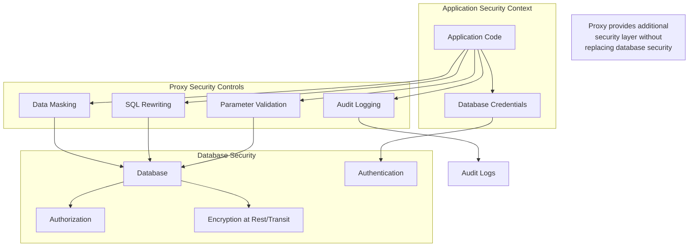

## 11. Monitoring and Observability

### Observable Events

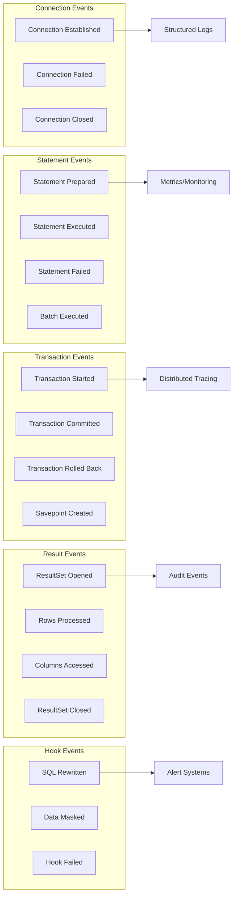

This comprehensive design document provides the technical foundation for understanding, extending, and operating the JDBC Proxy Driver in production environments.
