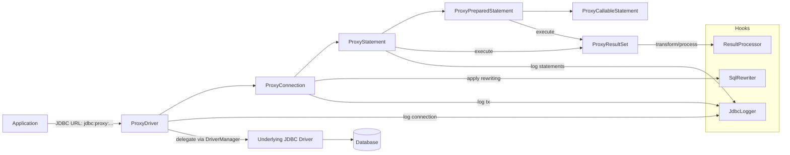
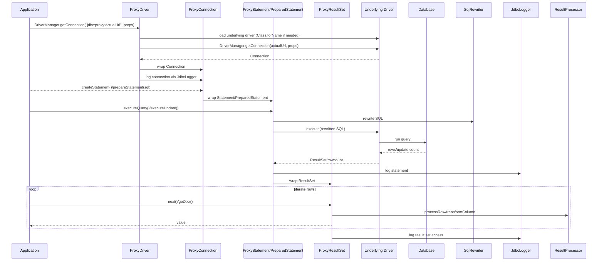
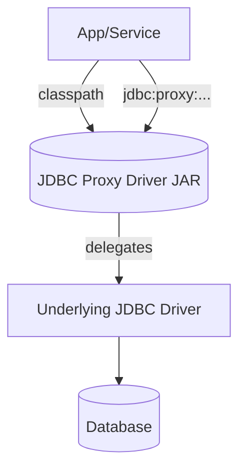

# JDBC Proxy Driver

A powerful JDBC driver proxy that provides hooks for logging, SQL rewriting, and result processing. Designed for debugging, monitoring, and instrumenting JDBC operations with minimal changes to existing code.

## Features

- **Transparent proxying**: Works as a drop-in replacement for existing JDBC drivers
- **Comprehensive logging**: Log connections, statements, transactions, and result set access patterns
- **SQL rewriting**: Modify SQL statements before execution (table prefixing, query optimization, etc.)
- **Result processing**: Transform or mask result data (security, data transformation, etc.)
- **Multiple configurations**: Support different configurations for different environments
- **Extensible**: Easy to add custom hooks and processors
- **Production ready**: Minimal performance overhead, thread-safe, robust error handling

## Quick Start

### 1. Add to your project

```xml
<dependency>
    <groupId>com.example</groupId>
    <artifactId>jdbc-proxy-driver</artifactId>
    <version>1.0.0</version>
</dependency>
```

### 2. Basic Usage

```java
import com.example.jdbcproxy.driver.ProxyDriver;
import com.example.jdbcproxy.extensions.ConsoleJdbcLogger;
import com.example.jdbcproxy.hooks.ProxyConfiguration;

// Configure the proxy
ProxyConfiguration config = ProxyDriver.getConfiguration("default");
config.addLogger(new ConsoleJdbcLogger());

// Use proxy URL instead of direct database URL
String originalUrl = "jdbc:h2:mem:testdb";
String proxyUrl = "jdbc:proxy:" + originalUrl;

// Connect normally - all JDBC operations will be logged
try (Connection conn = DriverManager.getConnection(proxyUrl, "user", "password")) {
    // Your existing JDBC code works unchanged
    try (PreparedStatement stmt = conn.prepareStatement("SELECT * FROM users WHERE id = ?")) {
        stmt.setInt(1, 123);
        try (ResultSet rs = stmt.executeQuery()) {
            // Results and operations are automatically logged
            while (rs.next()) {
                System.out.println(rs.getString("name"));
            }
        }
    }
}
```

### 3. Console Output

```
[14:32:15.123] CONNECTION [45ms]: Connected to jdbc:h2:mem:testdb (user: sa)
[14:32:15.168] STATEMENT [12ms]: SELECT * FROM users WHERE id = ? | Parameters: [123] | Rows: 1
[14:32:15.180] RESULTSET: SELECT * FROM users WHERE id = ? | Rows read: 1 | Columns accessed: [id, name]
```

## URL Format

The proxy driver uses a simple URL format:

```
jdbc:proxy:<original-jdbc-url>
```

Examples:
- `jdbc:proxy:jdbc:h2:mem:testdb`
- `jdbc:proxy:jdbc:postgresql://localhost:5432/mydb`
- `jdbc:proxy:jdbc:mysql://localhost:3306/mydb`

## Configuration

### Multiple Configurations

You can create different configurations for different environments:

```java
// Development configuration with verbose logging
ProxyConfiguration devConfig = new ProxyConfiguration();
devConfig.addLogger(new ConsoleJdbcLogger(true, true)); // Log parameters and timing
devConfig.addRewriter(new TablePrefixRewriter("dev_"));

ProxyDriver.setConfiguration("development", devConfig);

// Production configuration with data masking
ProxyConfiguration prodConfig = new ProxyConfiguration();
prodConfig.addLogger(new ConsoleJdbcLogger(false, false)); // Minimal logging
prodConfig.addProcessor(new DataMaskingProcessor());

ProxyDriver.setConfiguration("production", prodConfig);

// Use specific configuration
Properties props = new Properties();
props.setProperty("user", "myuser");
props.setProperty("password", "mypassword");
props.setProperty("proxy.configKey", "development"); // Use dev config

Connection conn = DriverManager.getConnection(proxyUrl, props);
```

### Connection Properties

| Property | Description | Example |
|----------|-------------|---------|
| `proxy.configKey` | Configuration to use | `"development"` |
| `proxy.underlyingDriver` | Force load specific driver class | `"org.h2.Driver"` |

## Built-in Extensions

### Console JDBC Logger

Logs all JDBC operations to the console:

```java
// Basic logger
config.addLogger(new ConsoleJdbcLogger());

// Customized logger
config.addLogger(new ConsoleJdbcLogger(
    true,  // logParameters - include parameter values in logs
    true   // logTiming - include execution timing
));
```

**Output Example:**
```
[14:32:15.123] CONNECTION [45ms]: Connected to jdbc:h2:mem:testdb (user: sa)
[14:32:15.168] STATEMENT [12ms]: SELECT * FROM users WHERE name = ? | Parameters: ["John Doe"] | Rows: 1
[14:32:15.175] TRANSACTION [3ms]: COMMIT
[14:32:15.180] BATCH [25ms]: INSERT INTO logs VALUES (?, ?) | Batch size: 100 | Total updates: 100
```

### Table Prefix Rewriter

Automatically adds prefixes to table names (useful for multi-tenancy):

```java
config.addRewriter(new TablePrefixRewriter("tenant1_"));

// This SQL: "SELECT * FROM users WHERE id = 1"
// Becomes:   "SELECT * FROM tenant1_users WHERE id = 1"
```

### Data Masking Processor

Masks sensitive data in result sets:

```java
config.addProcessor(new DataMaskingProcessor());

// Sensitive columns like 'password', 'ssn', 'credit_card' are automatically masked
// "secret123" becomes "s*****3"
// "john@example.com" becomes "j*************m"
```

Custom sensitive columns:
```java
DataMaskingProcessor masker = new DataMaskingProcessor();
masker.addSensitiveColumn("api_key");
masker.addSensitiveColumn("auth_token");
config.addProcessor(masker);
```

## Creating Custom Extensions

### Custom Logger

```java
public class FileJdbcLogger implements JdbcLogger {
    private final PrintWriter writer;
    
    public FileJdbcLogger(String filename) throws IOException {
        this.writer = new PrintWriter(new FileWriter(filename, true));
    }
    
    @Override
    public void logStatement(String originalSql, String rewrittenSql, List<Object> parameters,
                           Connection connection, long startTime, long endTime,
                           int rowCount, SQLException exception) {
        writer.printf("[%s] %s | Duration: %dms | Rows: %d%n",
                     new Date(), originalSql, endTime - startTime, rowCount);
        writer.flush();
    }
    
    @Override
    public int getPriority() {
        return 0; // Default priority
    }
}
```

### Custom SQL Rewriter

```java
public class SecurityRewriter implements SqlRewriter {
    @Override
    public String rewriteSql(String sql, Connection connection) {
        // Add security constraints to SELECT statements
        if (sql.trim().toUpperCase().startsWith("SELECT")) {
            // Add WHERE clause to restrict access
            return sql + " AND tenant_id = getCurrentTenantId()";
        }
        return sql;
    }
    
    @Override
    public int getPriority() {
        return 200; // High priority - run early
    }
}
```

### Custom Result Processor

```java
public class AuditProcessor implements ResultProcessor {
    @Override
    public void processRow(ResultSet resultSet, String sql, Connection connection) 
            throws SQLException {
        // Log access to sensitive tables
        if (sql.toLowerCase().contains("users") || sql.toLowerCase().contains("accounts")) {
            String userId = getCurrentUserId();
            logAuditEvent("DATA_ACCESS", userId, sql);
        }
    }
    
    @Override
    public Object transformColumnValue(int columnIndex, String columnName, Object value,
                                     ResultSet resultSet, String sql, Connection connection) 
            throws SQLException {
        // Convert timestamps to user's timezone
        if (value instanceof Timestamp && columnName.endsWith("_at")) {
            return convertToUserTimezone((Timestamp) value);
        }
        return value;
    }
}
```

## Advanced Features

### Priority System

All hooks support priorities to control execution order:

```java
public class HighPriorityRewriter implements SqlRewriter {
    @Override
    public int getPriority() {
        return 1000; // Higher numbers execute first
    }
    
    @Override
    public String rewriteSql(String sql, Connection connection) {
        // This runs before lower priority rewriters
        return sql;
    }
}
```

### Error Handling

The proxy driver is designed to be resilient:

- Exceptions in hooks don't break the main SQL execution
- Failed hooks are logged but don't propagate
- The underlying JDBC operation continues normally

### Performance Considerations

- Hooks are only called when enabled in configuration
- Minimal overhead when no hooks are configured
- Thread-safe for concurrent access
- Connection pooling works normally

## Integration Examples

### Spring Boot Configuration

```java
@Configuration
public class JdbcProxyConfig {
    
    @Bean
    @Primary
    public DataSource proxyDataSource(@Value("${app.database.url}") String dbUrl) {
        // Configure proxy
        ProxyConfiguration config = ProxyDriver.getConfiguration("app");
        config.addLogger(new ConsoleJdbcLogger());
        config.addProcessor(new DataMaskingProcessor());
        
        // Create DataSource with proxy URL
        HikariConfig hikariConfig = new HikariConfig();
        hikariConfig.setJdbcUrl("jdbc:proxy:" + dbUrl);
        hikariConfig.setUsername("${app.database.username}");
        hikariConfig.setPassword("${app.database.password}");
        hikariConfig.addDataSourceProperty("proxy.configKey", "app");
        
        return new HikariDataSource(hikariConfig);
    }
}
```

### Testing Integration

```java
@TestConfiguration
public class TestJdbcProxyConfig {
    
    @Bean
    @Profile("test")
    public ProxyConfiguration testConfig() {
        ProxyConfiguration config = new ProxyConfiguration();
        config.addLogger(new FileJdbcLogger("test-queries.log"));
        config.addRewriter(new TablePrefixRewriter("test_"));
        
        ProxyDriver.setConfiguration("test", config);
        return config;
    }
}
```

## Building and Testing

### Build the project

```bash
mvn clean compile
```

### Run tests

```bash
mvn test
```

### Run integration tests

```bash
mvn integration-test
```

### Package

```bash
mvn package
```

## Requirements

- Java 21 or higher
- Maven 3.6 or higher
- SLF4J 2.0+ (for logging)

## License

This project is licensed under the MIT License - see the LICENSE file for details.

## Contributing

1. Fork the project
2. Create a feature branch (`git checkout -b feature/amazing-feature`)
3. Commit your changes (`git commit -m 'Add amazing feature'`)
4. Push to the branch (`git push origin feature/amazing-feature`)
5. Open a Pull Request

## Support

For questions, issues, or contributions, please:

1. Check the [existing issues](https://github.com/your-repo/jdbc-proxy-driver/issues)
2. Create a new issue if needed
3. Provide sample code and configuration when reporting bugs

## System Design

This section provides a high-level overview of how the JDBC Proxy Driver is structured and how requests flow through the system.

### Architecture Overview

ASCII overview diagram:
```
+---------------------------+                 +--------------------------+
|        Application        |  JDBC calls     |   Underlying JDBC Driver |
|  (your code / frameworks) +---------------->+  & Database Connection   |
|         uses JDBC         |                 |      (H2, Pg, MySQL)    |
+-------------+-------------+                 +------------+-------------+
              |                                           ^
              |                                           |
              v                                           |
+-------------+-------------+     delegates    +----------+-------------+
|       JDBC Proxy Driver   |----------------->|   Real Driver/DB       |
|  - ProxyDriver            |                  |  via DriverManager     |
|  - ProxyConnection        |                  +------------------------+
|  - ProxyStatement(s)      |
|  - ProxyResultSet         |
|  Hooks / Extensions:      |
|    - SqlRewriter(s)       |
|    - ResultProcessor(s)   |
|    - JdbcLogger(s)        |
+---------------------------+
```

### Mermaid: Component Diagram


### Mermaid: Request Flow (Sequence)


### Deployment Considerations
- The proxy is a library embedded in your application process; no separate service is required.
- Works with any pool (HikariCP, DBCP, etc.) by pointing the pool to the proxy URL.
- Multiple configurations supported via `proxy.configKey`.



### Performance Notes
- When hooks are disabled: overhead is near zero (straight delegation).
- Logging/rewriting adds minimal overhead (string ops and iteration over small lists).
- Result processing runs per row only when a processor is configured.

### Failure Modes & Safety
- Hook exceptions are caught and logged; core JDBC call still proceeds.
- Underlying driver errors are propagated unchanged.
- Thread-safe configuration; hook lists are `CopyOnWriteArrayList`.

---

## Roadmap

- [ ] Support for database-specific optimizations
- [ ] Metrics collection and export (Prometheus, etc.)
- [ ] Connection pool monitoring
- [ ] Query performance analytics
- [ ] Automatic SQL injection detection
- [ ] Result set caching
- [ ] Distributed tracing integration
